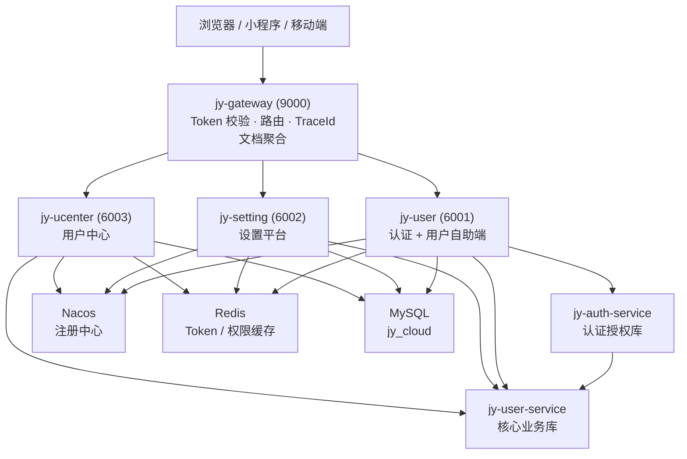
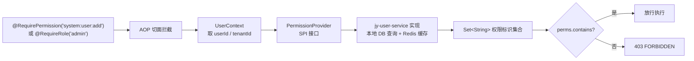
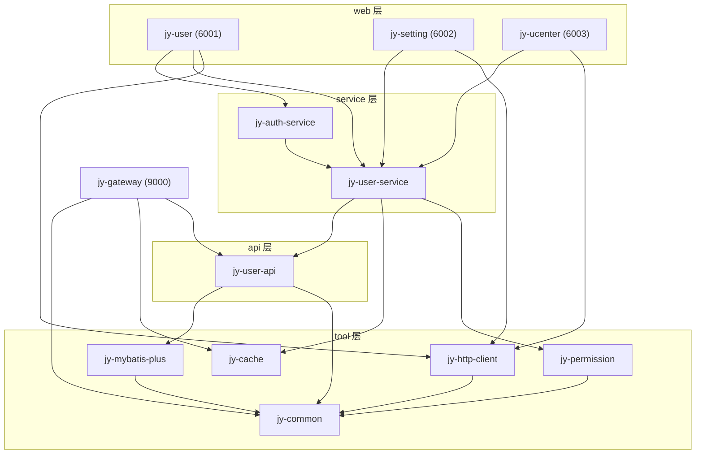

# JYCloud

JYCloud SaaS 版微服务平台：多租户隔离、模块化微服务架构。核心业务逻辑沉淀为服务层库（jy-user-service / jy-auth-service），由多个 Web 应用引用并独立部署，统一经 Gateway 认证与路由。

## 技术栈

| 类别 | 技术 | 版本 |
|---|---|---|
| 基础框架 | Spring Boot | 4.1.1 |
| 微服务 | Spring Cloud | 2025.1.2 |
| 微服务组件 | Spring Cloud Alibaba | 2025.1.0.0 |
| 注册中心 | Nacos（服务注册发现） | 3.x |
| 网关 | Spring Cloud Gateway Server WebFlux / Netty | 5.x |
| ORM | MyBatis-Plus（含 jsqlparser 多租户 SQL 解析） | 3.5.17 |
| 数据库 | MySQL | 8.x |
| 数据源 | dynamic-datasource / Druid（可选，provided 依赖） | 4.5.0 / 1.2.28 |
| 缓存 | Redis（Lettuce + Commons Pool2） | — |
| JSON | Fastjson2（含 Spring 6/7 / Redis 扩展） | 2.0.65 |
| API 文档 | Knife4j Next（Gateway 聚合模式） | 5.4.0 |
| JWT | java-jwt（Auth0） | 4.5.2 |
| 微信小程序 | weixin-java-miniapp（支持多小程序配置） | 4.7.0 |
| IP 归属 | ip2region | 3.3.7 |
| 线程上下文 | transmittable-thread-local | 2.14.5 |
| Java | JDK 21 | — |
| 构建 | Maven 多模块 | — |

## 依赖管理约定

- 根 `pom.xml` 只集中管理版本，并全局提供 `Lombok` 与 `spring-boot-starter-test`。
- `jy-common` 导出 Swagger、Jackson、Validation、Fastjson2、JWT、`BaseEntity/TenantEntity`
  及 `mybatis-plus-annotation`；只引入 MyBatis 核心，不包含 Starter、数据源或 Mapper 自动配置。
- `jy-mybatis-plus` 导出持久层实现和 `jy-common`；MySQL 驱动、Druid、动态数据源由应用运行时提供。
- `jy-http-client`、`jy-log-client` 的 Servlet/WebMVC 依赖保持 `provided`，不向 WebFlux Gateway 传递。
- `web/pom.xml` 统一提供三个 Servlet 应用共用的 Web、Nacos、LoadBalancer、Knife4j、MySQL、日志与 HTTP 客户端依赖。
- 业务子模块只声明自身独有的 Service/API 依赖，内部模块版本统一由根 POM 管理。

## 项目结构

```
jycloud/
├── gateway/                       # API 网关（端口 9000，WebFlux / Netty）
│   ├── filter/
│   │   ├── AuthGlobalFilter.java        # Token 校验（JWT 解密 + Redis 会话比对）+ 用户/租户头透传
│   │   └── TraceIdGatewayFilter.java    # 链路追踪 ID
│   ├── config/CorsConfig.java           # 跨域
│   ├── handler/GatewayExceptionHandler.java
│   └── controller/DiscoveryClientController.java
│
├── api/                           # 跨服务共享契约（HttpExchange + 实体 + DTO/VO + 常量）
│   ├── jy-log-client/             # 四类日志注解、切面、异步写入与错误捕获
│   ├── jy-user-api/
│   │   ├── entity/  dto/  vo/  constant/
│   │   └── client/UserAuthorityClient.java  # HttpExchange 接口（由 RestClient 动态代理）
│   └── jy-user-permission/        # 业务服务远程权限桥接（PermissionProvider / RoleProvider）
│
├── service/                       # 服务层（业务逻辑库，打包进 web 应用运行）
│   ├── jy-user-service/           # 核心业务库：用户/角色/菜单/部门/租户/Client/字典/区域等
│   │                               # 16+ Service + Mapper、Assemble 聚合、Redis 缓存、权限 SPI Provider
│   └── jy-auth-service/           # 认证授权库：授权策略分发（password/wechat/switch_tenant 等 TokenGranter）
│
├── web/                           # Web 层（可独立部署的应用，均复用 jy-user-service）
│   ├── jy-user/                   # 端口 6001：认证 + 用户自助端
│   ├── jy-setting/                # 端口 6002：设置平台
│   └── jy-ucenter/                # 端口 6003：用户中心
│
├── tool/                          # 技术基础模块（各服务共用）
│   ├── jy-common/                 # 通用：ServerResponse/ResponseCode、SysException、JWTUtil、UserContext、工具类
│   ├── jy-http-client/            # REST HTTP 客户端拦截器（透传 Token 与用户/租户上下文头）
│   ├── jy-mybatis-plus/           # BaseEntity/TenantEntity、MP 自动配置（多租户插件、分页等）
│   ├── jy-cache/                  # Redis 封装（RedisTemplate 配置 + RedisCacheHelper）
│   ├── jy-permission/             # 权限控制（@RequirePermission / @RequireRole + AOP + SPI）
│   └── jy-code-generator/         # MyBatis-Plus 代码生成器（FastAutoGenerator）
│
└── sql/                           # 数据库脚本
    ├── jy_cloud.sql               # 全量库表结构 + 基础数据
    ├── setting_menu.sql           # 设置平台菜单（perms）
    ├── ucenter_menu.sql           # 用户中心菜单（perms）
    ├── init_t_client.sql          # 业务系统（Client）初始数据
    └── log.sql                    # 登录/操作/API/错误日志表
```

## 架构总览



> jy-user-service、jy-auth-service 为**服务端库**而非独立进程，以依赖方式随 Web 应用打包部署（当前为"共享业务库 + 多应用"的部署形态，后续可按需拆分独立服务）。

## 服务职责

| 模块 | 类型 | 职责 |
|---|---|---|
| **gateway** | 网关（9000） | 路由（/jy-user、/jy-setting、/jy-ucenter）、Token 认证（白名单 + 文档自动放行）、用户/租户头透传、TraceId、CORS、Knife4j 文档聚合 |
| **jy-user-service** | 服务库 | 核心业务逻辑：用户、角色、菜单、部门、租户、业务系统（Client/版本）、字典、区域、数据权限、用户↔租户/部门/Client 绑定等；含 Assemble 聚合与 Redis 缓存 |
| **jy-auth-service** | 服务库 | 认证授权策略：账号密码、微信小程序、unionid、token 授权、切换租户；Token 签发与会话管理 |
| **jy-user** | 应用（6001） | 登录/登出、个人资料、修改密码、我的应用列表、用户路由菜单、用户查询；对外提供内部 HTTP 权限接口 |
| **jy-setting** | 应用（6002） | 设置平台：租户管理、业务系统 Client 与版本、租户-业务系统绑定、用户-租户、字典、区域、用户/角色/菜单管理 |
| **jy-ucenter** | 应用（6003） | 用户中心：用户/角色/菜单/部门管理、用户权限绑定（角色、直接分配菜单）、数据权限、用户-部门、用户-租户 |

## 认证与权限

### 认证流程

```
请求 → Gateway AuthGlobalFilter
        ├── 固定白名单放行：/jy-user/system/auth/login、/error、/favicon.ico
        ├── 文档路径自动放行：/{服务}/v3/api-docs|doc.html|swagger-ui|webjars…（正则匹配，新增服务无需改代码）
        ├── Token 校验：Header Token → JWT 解密 → 取 userId → 与 Redis 中
        │    会话（uc:token:{userId}）比对，不一致/不存在 → 401 UNAUTHORIZED
        └── 透传请求头：X-User-Id / X-Username / X-Tenant-Id → 下游服务 UserContext
```

- 登录签发的 Token 为**加密 JWT**，同时在 Redis 保存**服务端会话**（按用户维度单值）；
- 退出登录删除 Redis 会话，使已签发的 Token 立即失效；
- 登出/新设备登录会使旧 Token 失效；微信授权在客户端 IP 不变时复用已有 Token，避免将其他设备挤下线。

### 多端登录（jy-auth-service 策略分发）

登录接口 `POST /jy-user/system/auth/login` 通过 `grantType` 分发到对应 TokenGranter（策略模式，新增授权方式只需实现 `ITokenGranter`）：

| grantType | 说明 |
|---|---|
| `password` | 用户名或手机号 + 密码（MD5 + 独立随机盐）登录 |
| `wechat` | 微信小程序登录（code2session + 授权手机号） |
| `wechat_unionid` | 微信小程序 unionid 登录 |
| `authorization` | 已持有 Token 直接授权（复用现有会话，不重新生成） |
| `switch_tenant` | 切换租户登录（复用 Token，重新组装目标租户下的角色/权限） |

登录成功返回 `AuthInfo`：Token、用户信息、当前租户、可用租户列表、角色标识集合、权限标识集合（缓存优先）。

### 权限控制

采用**自定义 AOP 方案**（不使用 Shiro / Sa-Token），核心模块 `tool/jy-permission`：



**使用方式**：

```java
// 1. 各服务引入依赖
<dependency>
    <groupId>com.jycloud</groupId>
    <artifactId>jy-permission</artifactId>
</dependency>

// 2. SPI Provider 由 jy-user-service 提供默认实现（查询本地权限表 + 缓存）
// 3. Controller 标注注解
@RequirePermission("system:user:add")
@PostMapping
public ServerResponse<UserVO> create(...) { ... }
```

### 权限数据模型

```
t_user ──→ t_user_authority ──→ category=0 → t_role → t_role_menu → t_menu.perms
                              ──→ category=1 → t_menu.perms（直接分配）

数据权限维度：t_user_dept（用户-部门）、t_user_data_permission（自定义数据权限）
租户维度：   t_user_tenant（用户-租户多对多，含默认租户标记）
```

用户可同时通过**角色继承**和**直接分配菜单**两种方式获得权限标识；角色/权限标识集合在 Redis 中按（userId + tenantId）缓存，数据变更后失效重建。

## 服务间通信

服务间接口统一使用 Spring `@HttpExchange` 声明，并通过 `RestClient + HttpServiceProxyFactory` 生成客户端代理。`@LoadBalanced RestClient.Builder` 负责按 Nacos 服务名解析实例，`UserContextRequestInterceptor` 负责透传 Token、租户、应用、项目与链路追踪请求头。

用户权限客户端默认访问 `http://jy-user`，可按环境覆盖：

```yaml
jy:
  user-authority:
    client:
      base-url: http://jy-user
      connect-timeout: 5s
      read-timeout: 30s
```

## 多租户

- 用户可关联**多个租户**（`t_user_tenant`，支持默认租户），登录或切换租户（`switch_tenant`）后确定当前租户；
- Gateway 认证后从 Token 解析 `tenantId`，通过 `X-Tenant-Id` 请求头透传，服务端 `UserContext.getTenantId()` 全局可用；
- 隔离手段（双保险）：
  - **MyBatis-Plus 租户插件**：通过 `sys.tenant` 配置（`enabled` / `column` / `tables`）对指定关联表自动拼接租户条件；
  - **Mapper XML 显式过滤**：`WHERE tenant_id = #{tenantId}`，业务查询按需携带。

## 快速开始

### 环境要求

- JDK 21（源码编译级别 21）
- Maven 3.8+
- MySQL 8.x
- Redis 6+
- Nacos 3.x

### 数据库初始化

```sql
-- 1. 创建库并导入全量表结构与基础数据
source sql/jy_cloud.sql;

-- 2. 按需导入各应用菜单（含权限标识 perms）
source sql/setting_menu.sql;   -- 设置平台
source sql/ucenter_menu.sql;   -- 用户中心

-- 3. 业务系统（Client）初始数据（按需）
source sql/init_t_client.sql;
```

### 构建

```bash
# 构建整个项目（tool → api → service → web → gateway）
mvn clean install

# 仅构建某个应用及其依赖
mvn clean install -pl web/jy-user -am
```

> Spring Boot 4 升级说明：本项目已切换到 Spring Cloud Gateway 5 的
> `spring-cloud-starter-gateway-server-webflux` 依赖，并将网关路由配置前缀调整为
> `spring.cloud.gateway.server.webflux.routes`。旧的 `spring.cloud.gateway.routes`
> 在新版本中不会加载网关路由。

### 启动

```bash
# 1. 启动 Nacos、MySQL、Redis（dev 环境默认连接 120.27.143.176，
#    可用环境变量覆盖：DB_USERNAME/DB_PASSWORD/REDIS_HOST/REDIS_PORT/REDIS_PASSWORD/REDIS_DATABASE）

# 2. 启动 Gateway（端口 9000，默认 dev profile）
cd gateway
mvn spring-boot:run

# 3. 启动业务应用（端口：jy-user=6001，jy-setting=6002，jy-ucenter=6003）
cd web/jy-user
mvn spring-boot:run
```

### API 文档

启动后访问：`http://localhost:9000/doc.html`

Gateway 通过 Knife4j（discover 聚合模式）自动聚合注册中心内所有微服务的 API 文档，新增服务无需额外配置。

### 环境切换

根 pom 内置 dev（默认）/ test / prod 三个 profile，用于替换配置文件占位符：

```bash
mvn spring-boot:run -Dspring-boot.run.profiles=prod
```

## 模块依赖图


