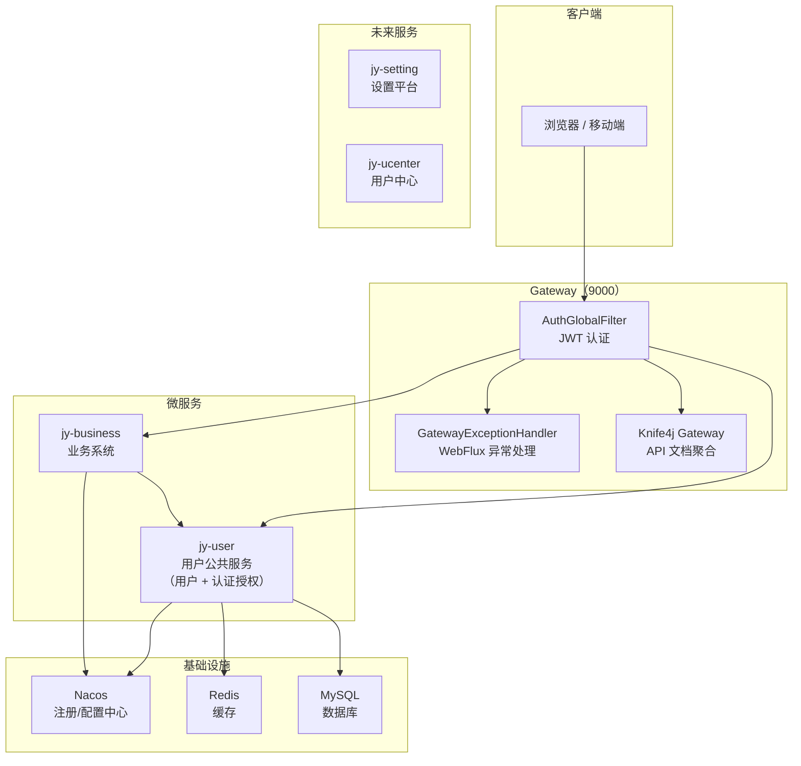
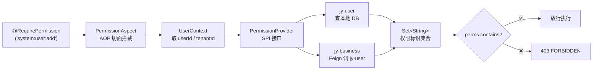
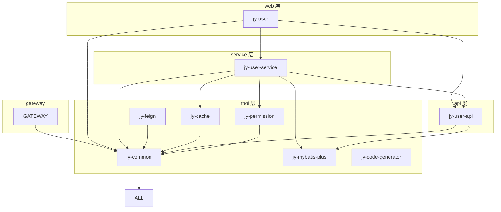

# JYCloud

JYCloud SaaS 版微服务平台

## 技术栈

| 类别 | 技术 | 版本 |
|---|---|---|
| 基础框架 | Spring Boot | 3.2.5 |
| 微服务 | Spring Cloud | 2023.0.1 |
| 注册中心 | Nacos | 2023.0.1.2 |
| 网关 | Spring Cloud Gateway（WebFlux / Netty） | — |
| ORM | MyBatis-Plus | 3.5.9 |
| 数据库 | MySQL | 8.2+ |
| 连接池 | Druid | 1.2.20 |
| 缓存 | Redis（Lettuce + Commons Pool2） | — |
| JSON | Fastjson2 | 2.0.53 |
| API 文档 | Knife4j（Gateway 聚合模式） | 4.5.0 |
| JWT | java-jwt（Auth0） | 4.4.0 |
| Java | JDK 17 | — |
| 构建 | Maven 多模块 | — |

## 项目结构

```
jycloud/
├── gateway/                  # API 网关（WebFlux / Netty）
│   ├── filter/
│   │   ├── AuthGlobalFilter.java        # JWT 认证 + 用户信息透传
│   │   └── TraceIdGatewayFilter.java    # 链路追踪 ID
│   └── handler/
│       └── GatewayExceptionHandler.java # WebFlux 全局异常处理
│
├── api/                      # Feign 接口 + 实体 + DTO（跨服务共享）
│   └── jy-user-api/
│       ├── entity/           # User、Role、Menu、UserAuthority 等
│       ├── dto/              # 请求 DTO
│       └── vo/               # 响应 VO
│
├── service/                  # 业务服务层
│   └── jy-user-service/
│       ├── service/          # 业务逻辑
│       ├── repository/mapper/# MyBatis Mapper
│       └── cache/            # Redis 缓存层
│
├── web/                      # Web 层（Controller）
│   └── jy-user/
│       └── controller/       # REST 接口
│
└── tool/                     # 技术基础模块（所有服务共用）
    ├── jy-common/            # 通用工具：ServerResponse、SysException、JWTUtil、UserContext
    ├── jy-feign/             # Feign 拦截器（透传 Token + 租户头）
    ├── jy-mybatis-plus/      # MP 基类（BaseEntity、TenantEntity）
    ├── jy-cache/             # Redis 缓存封装（RedisTemplate + RedisCacheHelper）
    ├── jy-permission/        # 权限控制（@RequirePermission + SPI + AOP）
    └── jy-code-generator/    # MyBatis-Plus 代码生成器
```

## 架构总览



## 服务职责

| 服务 | 职责 | 状态 |
|---|---|---|
| **gateway** | API 网关：JWT 认证、路由转发、跨域、API 文档聚合 | ✅ 已实现 |
| **jy-user** | 用户公共服务：用户 CRUD、权限查询、认证授权（登录/注册/登出、JWT 签发）、Feign 接口 | ✅ 已实现 |
| **jy-business** | 业务系统：纯业务逻辑，通过 Feign 调 jy-user 获取用户/权限数据 | 🔜 规划中 |
| **jy-ucenter** | 用户中心：角色 CRUD、用户↔角色绑定、数据权限 | 🔜 规划中 |
| **jy-setting** | 设置平台：租户管理、菜单定义（perms）、字典、日志 | 🔜 规划中 |

## 认证与权限

### 认证流程

```
请求 → Gateway AuthGlobalFilter
        ├── 白名单放行（/jy-user/system/auth/*、Swagger 文档等）
        ├── 校验 JWT Token（解密 + 验签）
        └── 透传头部：X-User-Id / X-Username / X-Tenant-Id
```

### 权限控制

采用**自定义 AOP 方案**（不使用 Shiro / Sa-Token），核心模块 `tool/jy-permission`：



**使用方式**：

```java
// 1. 各服务引入依赖
<dependency>
    <groupId>com.jycloud</groupId>
    <artifactId>jy-permission</artifactId>
</dependency>

// 2. 注入 PermissionProvider 实现
@Component
public class DbPermissionProvider implements PermissionProvider {
    public Set<String> getPermissions(String userId, String tenantId) {
        // 查询权限表
    }
}

// 3. Controller 标注注解
@RequirePermission("system:user:add")
@PostMapping
public ServerResponse<UserVO> create(...) { ... }
```

### 权限数据模型

```
t_user ──→ t_user_authority ──→ category=0 → t_role → t_role_menu → t_menu.perms
                              ──→ category=1 → t_menu.perms（直接分配）
```

混合权限模型：用户可同时通过**角色继承**和**直接分配菜单**两种方式获得权限标识。

## 多租户

所有数据操作强制带上 `tenant_id` 隔离：

- Gateway 认证后从 JWT 解析 `tenantId`，通过 `X-Tenant-Id` 头部透传
- 服务端 `UserContext.getTenantId()` 全局可用
- MyBatis Mapper XML 中通过 `WHERE tenant_id = #{tenantId}` 过滤

## 快速开始

### 环境要求

- JDK 17+
- Maven 3.8+
- MySQL 8.0+
- Redis 6+
- Nacos 2.x

### 构建

```bash
# 构建整个项目
mvn clean install

# 仅构建 tool 层模块
mvn clean install -pl tool -am

# 仅构建 jy-user 服务
mvn clean install -pl service/jy-user-service,web/jy-user -am
```

### 启动

```bash
# 1. 启动 Nacos（默认 dev 环境：120.27.143.176:8848）

# 2. 启动 Gateway（端口 9000）
cd gateway
mvn spring-boot:run

# 3. 启动 jy-user 服务（web 模块）
cd web/jy-user
mvn spring-boot:run
```

### API 文档

启动后访问：`http://localhost:9000/doc.html`

Gateway 通过 Knife4j 聚合模式统一展示所有微服务的 API 文档。

### 环境切换

```bash
mvn spring-boot:run -Dspring-boot.run.profiles=prod
```

## 模块依赖图


